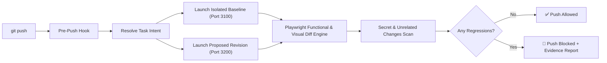

<div align="center">

# 🛡️ ProofPush

### Never push broken website code again.

**A local-first pre-push gatekeeper that spins up your site before and after changes, tests real user behavior with Playwright, and blocks regressions before they hit remote.**

[](https://www.python.org/downloads/)
[](https://playwright.dev/)
[](https://opensource.org/licenses/MIT)
[](#privacy--local-first)

</div>

---

## ⚡ Why ProofPush?

AI coding agents (Claude Code, Cursor, Codex, Gemini CLI) write code fast—**and break websites silently**. 

Conventional linters and code-review bots only read text diffs. They don't know that:
- Your checkout button became unclickable.
- A CSS tweak pushed the navigation bar offscreen on mobile.
- A missing import in client-side code triggers a silent `TypeError` in DevTools.
- An accidental edit introduced an unrelated breaking change or leaked an API key.

**ProofPush tests what your website actually does, not just how its source code looks.**

```
$ git push origin main

============================================================
                         PROOFPUSH
              Local Website Regression Auditor
============================================================
Repository:   ~/projects/acme-store
Task:         Add coupon support to checkout
Baseline:     7ac19f2 → Proposed: a41c0d8
Mode:         STRICT
------------------------------------------------------------
ROUTES CHECKED:       12
FUNCTIONAL WORKFLOWS: 8
VISUAL COMPARISONS:   12 (Desktop & Mobile)
------------------------------------------------------------
RESULTS:
  Passed:             18
  Expected changes:    1
  Regressions:         1
------------------------------------------------------------
🚨 REGRESSION DETECTED
Target: /checkout.html
Before: All network assets and API requests succeeded.
After:  Uncaught TypeError: Cannot read property 'calculateTotal'
Evidence:
- Step 2 failed in workflow 'Standard Checkout'
- Console error captured in DevTools trace
- HTML Evidence Viewer: .proofpush/reports/latest.html
------------------------------------------------------------
🛑 RECOMMENDATION: PUSH BLOCKED
Fix the checkout error or use git push --no-verify to override.
============================================================
```

---

## 🚀 Quickstart (30 Seconds)

### 1. One-Line Install
```bash
git clone https://github.com/mmhtanvir/ProofPush.git
cd ProofPush
./install.sh
```
> Installs Python dependencies, downloads Playwright Chromium binaries, and links the `proofpush` CLI.
>
> Installing with pip instead? `pip install 'proofpush[browser] @ git+https://github.com/mmhtanvir/ProofPush'` for everything, or without `[browser]` for the git-only checks (deployment gate, reverted fixes, push rules, secrets).

### 2. Enable in Any Repository
```bash
cd ~/your-web-project
proofpush install
```
That's it! Every `git push` (from terminal, VS Code, Cursor, or AI CLI) will now be tested before leaving your machine.

---

## 💡 What It Does Behind the Scenes



1. **Zero Working Tree Pollution**: Runs baseline vs proposed in isolated temporary Git worktrees on dynamic ports. Your active files are never touched.
2. **Context-Aware Comparison**: Distinguishes intentional changes from accidental regressions using your commit messages, a `.proofpush-task.md` file, or the `PROOFPUSH_TASK` environment variable.
3. **Visual Diffing**: Normalizes viewport dimensions, freezes animations, and generates visual bounding boxes for shifted elements.
4. **Leak Guard**: Scans diffs for leaked secrets (`sk-...`, AWS keys, tokens) and flags deleted test suites.
5. **Chains Existing Hooks**: Preserves your existing pre-push hooks by automatically backing them up and chaining them.
6. **Fixed Bugs Stay Fixed (zero config)**: Reads your Git history for past fix commits (`fix`, `bug`, `hotfix`, ...) touching the files you're pushing, and flags the push if it brings their buggy code back. Works in any language or framework, no setup. Pushes to an existing branch are compared against what is live on it now, so a force-push from a stale checkout can't hide a reverted fix. Add `guard: true` workflows to pin specific bugs in the browser too.

---

## 🚦 Deployment Gate: Prod Stays on the Last Good Release

The pre-push hook only protects machines that have it. To guarantee prod never receives a release that brings back a fixed bug, run `proofpush gate` where you deploy. It compares the commit **live now** with the one **about to deploy**: reverted past fixes, the 103 suspicious-push rules, secrets, and (given two URLs) every page side by side as the test account. It is always strict and never prompts. If the release is rejected, prod stays where it is and your team webhook / desktop gets the reason.

**Frontend on Vercel** uses the Ignored Build Step: a rejected release shows as **Canceled** in Vercel and production keeps serving the current deployment. In `vercel.json`:

```json
{ "ignoreCommand": "python3 -m pip install -q 'proofpush @ git+https://github.com/mmhtanvir/ProofPush' && proofpush gate --vercel" }
```

This installs only the git checks (no browser), so it adds seconds, not minutes. If the install itself fails, the command exits non-zero and Vercel builds anyway, so a broken install never freezes deploys; the build log shows it. `--vercel` reads `VERCEL_GIT_PREVIOUS_SHA` (live) and `VERCEL_GIT_COMMIT_SHA` (new), deepens Vercel's shallow clone, gates only production deployments (previews always build), and inverts exit codes the way Vercel expects (0 = cancel).

**Backend (e.g. `deploy.sh` on a server)** is a plain exit code: 0 deploy, 1 reject.

```bash
LIVE=$(git rev-parse HEAD)
git fetch origin main
proofpush gate --base "$LIVE" --candidate origin/main || { echo "Rejected by ProofPush, staying on $LIVE"; exit 1; }
git merge --ff-only origin/main && sudo systemctl restart my-api
```

**Optional: compare the new frontend in the browser before it goes live.** Let Vercel build a preview, then gate it against prod, e.g. in GitHub Actions on `deployment_status` (with Vercel's Deployment Checks holding the production promotion until this check passes):

```yaml
on: deployment_status
jobs:
  gate:
    if: github.event.deployment_status.state == 'success'
    runs-on: ubuntu-latest
    steps:
      - uses: actions/checkout@v4
        with: { fetch-depth: 0 }
      - run: pip install 'proofpush[browser] @ git+https://github.com/mmhtanvir/ProofPush' && python -m playwright install --with-deps chromium
      - run: >
          proofpush gate --base origin/main --candidate ${{ github.event.deployment.sha }}
          --base-url https://your-site.com --candidate-url ${{ github.event.deployment_status.target_url }}
        env: { SHOP_PROD_USER: ${{ secrets.SHOP_PROD_USER }}, SHOP_PROD_PASSWORD: ${{ secrets.SHOP_PROD_PASSWORD }} }
```

Pages that were already broken on the live side are reported as notices, not blamed on the new release.

---

## 🔔 Knowing When a Push Was Blocked

- **Terminal:** the report prints right there, followed by git's `failed to push`.
- **Desktop notification:** when nobody is at a terminal (pushes from VS Code, GitHub Desktop, Cursor, an AI agent, or a scheduled `proofpush check`), ProofPush shows an OS notification: macOS Notification Center, `notify-send` on Linux, a tray balloon on Windows. On by default; never in CI.
- **Team channel:** send blocked pushes and failed prod checks to Slack, Discord, or any URL that accepts JSON (Zapier, n8n, your own endpoint):

```yaml
notify:
  desktop: true
  webhook_env: TEAM_WEBHOOK   # put TEAM_WEBHOOK=https://hooks.slack.com/services/... in .proofpush/secrets.env or your environment
```

Slack and Discord get a formatted message; other URLs get `{"text", "event", "repo", "branch"|"environment", "reason", "findings", "report"}`. Secrets are redacted before anything leaves your machine, and a dead webhook never delays a push by more than 5 seconds.

For prod, run `proofpush check --env prod` after each deploy (CI step) or on a schedule (cron); failures reach the same webhook.

---

## 🔐 Test Accounts: Check the Whole Site, Locally and in Prod

Give ProofPush a test account per environment and it logs in, crawls every page reachable by links, and checks each one, including pages behind the login.

```yaml
routes:
  base_routes: ["/dashboard"]   # start here; the first one should need login
  crawl: true                   # follow links to every reachable page
  max_pages: 50
auth:
  login_path: /login
  accounts:                     # names of env vars, never the passwords themselves
    local: {username_env: SHOP_USER,      password_env: SHOP_PASSWORD}
    prod:  {username_env: SHOP_PROD_USER, password_env: SHOP_PROD_PASSWORD, otp_secret_env: SHOP_PROD_OTP}
environments:
  prod: https://shop.example.com
```

Put the values in your shell environment or in `.proofpush/secrets.env` (`SHOP_USER=...`, one per line). ProofPush adds `.proofpush/` to `.git/info/exclude`, so it can't be committed.

- **Local (every push):** both versions are logged in with the `local` account and compared page by page. A push that breaks login is a regression.
- **Prod:** `proofpush check --env prod` logs in with the `prod` account and checks the live site. It is read-only: it follows links with GET, never submits forms, skips logout/delete/cancel links, and runs only workflows marked `prod: true`. Exits 1 on any broken page, so you can run it after a deploy or on a schedule.
- **Login form:** by default the first email/username and password fields are filled and submitted. For anything else, list `auth.steps` (same actions as workflows) using `{username}`, `{password}` and `{otp}`.

**One-time codes (2FA).** ProofPush never bypasses them:
- **Authenticator app (TOTP):** when enabling 2FA for the test account, save its setup secret (the text behind the QR code) as `otp_secret_env`. ProofPush generates the current code itself, fully automatic.
- **SMS / email codes, SSO, captchas:** run `proofpush login --env prod` once. A browser opens, you log in and type the code, and the session is saved to `.proofpush/session-prod.json` (kept out of git). Checks reuse it until it expires, then tell you to log in again.
  For local, point it at your dev server (`proofpush login --env local --url http://localhost:3000`); the session follows the audit to whatever port it runs each version on.

**CAPTCHAs (Cloudflare Turnstile, reCAPTCHA, hCaptcha).** ProofPush never solves them. When one blocks the login it says so, and how to get through:
- **Local:** run the app with the provider's official always-pass test keys through `application.env` (e.g. Turnstile site key `1x00000000000000000000AA`, secret `1x0000000000000000000000000000000AA`). The backend that verifies the token must use the test secret too.
- **Prod:** `proofpush login --env prod` once, solving the CAPTCHA yourself.

Use a dedicated low-privilege test account in prod, never an admin.

---

## 🖱️ Buttons That Stop Working, Slow Down or Get Glitchy

Turn on `interactions.auto_click` and, on every checked page, ProofPush clicks each safe button, toggle, tab and menu in **both** versions and compares what happened:

| Finding | Example |
|---|---|
| Stopped working | `'Star' stopped working: clicking it no longer changes anything` |
| Can't be clicked | now disabled, hidden, or covered by another element |
| Errors | `'Save filter' now throws errors when clicked: TypeError ...` |
| Slower | `'Load more' responds slower: 22 ms -> 908 ms` |
| Glitchy | `'Load more' freezes the page: main thread blocked 0 ms -> 851 ms`, or the layout jumps |
| Missing | `'Filters' is no longer on the page` |

```yaml
interactions:
  auto_click: true
  max_per_page: 8      # buttons per page
  max_pages: 10        # pages per audit
  skip: [approve, sync]  # extra words that mark a button as unsafe
  # allow_on_live: true  # also click on live sites (`check`, `gate --base-url`): only with a test account whose data can change
```

Safety: it never clicks anything that sounds destructive or data-changing (delete, pay, send, save, submit, approve, invite, logout, ...) or a form's submit button, and it clicks toggles (star, like, switch, menu) a second time to put them back. It is **opt-in** because a local copy of your app may talk to a real backend. Timing findings use generous margins (2x and +300 ms) so normal jitter doesn't trigger them.

---

## 🔌 Backend Breaks, Not Just Frontend

A page can look broken because the **backend** changed. ProofPush records every API call each page (and each clicked button) makes, in both versions, and tells you when the backend is the cause:

| Finding | Example |
|---|---|
| Call now errors | `Backend (seen on /patients): GET /api/patients/:id now returns 500 (was 200)` |
| Fields missing | `GET /api/profile no longer returns fields: email` |
| Data gone | `GET /api/orders now returns an empty 'items' (was 12 items)` |
| Slower | `GET /api/search got slower: 120 ms -> 2400 ms` |
| Button fails server-side | `'Star' now fails on the backend: POST /api/star -> 500` |

**API-only backends** (no pages): routes that return JSON are compared the same way. Routes are discovered from FastAPI, Flask, Express and Django `urls.py`; add others to `routes.base_routes`. If the API needs a token:

```yaml
api_headers:
  Authorization: "Bearer {API_TOKEN}"   # API_TOKEN from your environment or .proofpush/secrets.env
```

**The project's own tests, on both versions** (backend logic, calculations, jobs, emails: whatever your tests cover). A test that passed before and fails now is a regression, named in the report. Detected automatically: `npm test`, `pytest`, `manage.py test`, `go test`, `cargo test`.

```yaml
tests:
  enabled: true          # opt-in: some runners (e.g. Django) create a database on the server your app points at
  # command: "npm run test:unit"
  # timeout: 600
```

Each version runs in a temporary checkout with your installed dependencies (`node_modules`, `.venv`, ...) and `.env` files linked in, so real apps and test suites start without reinstalling.

---

## 🧪 API Payload Testing (backend, any framework)

Turn on `api_tests` and ProofPush sends the **same deterministic requests** to the old and the new version of your API and reports what broke: endpoints that disappeared, validation or auth that stopped working, fields that changed type, business rules that changed, a fixed bug that came back, or a version that stopped answering.

**How endpoints are found** (see them with `proofpush api discover [--url http://localhost:8000]`), most trusted first:
1. OpenAPI/Swagger: a file in the repo (`openapi.json`, `swagger.yaml`, `schema.yml`, ...) or the running app (`/openapi.json`, DRF `/api/schema/?format=json`, `/v3/api-docs`)
2. Framework routes: FastAPI, Flask, Django `urls.py` + DRF routers, Express, Next.js route handlers / `pages/api`, Go (`net/http`, chi, gin)
3. The API calls your frontend really makes during the page checks (concrete, known-good URLs)

Endpoints are discovered from **both** versions, so one the change deletes is still tested. Coverage is always reported: discovered, run, and not run (with the reason).

**Which requests are sent**: your explicit cases first, then for each endpoint a schema-valid request (examples, enums, formats, required fields), invalid ones (missing/null/wrong-type/empty/out-of-range/invalid-enum fields, malformed JSON, wrong query types) and a request without credentials where auth is required.

**What counts as broken**, strongest evidence first:

| Evidence | Example finding |
|---|---|
| Your assertion | `previously fixed bug is back: $.total is 2.5, expected 5.0` (a `guard: true` case blocks even if the old version fails too) |
| API contract (OpenAPI) | `$.items[0].price should be number, got str`, `status 201, expected 401/422` |
| Input validation | `accepted invalid input (missing required 'name') with 201` |
| Authentication | `responded 201 without credentials` |
| Feature removed | `endpoint removed: answered 200 before, now 404` |
| Server errors | `server error 500`, `candidate did not respond` |
| Baseline only | `$.total changed 5.0 -> 4.0`: a **potential** regression to confirm, never a confirmed one |

Timestamps and UUIDs are treated as dynamic; prices, statuses and every other value are compared unless you list the field in `normalize_fields`. Failures that also happen on the old version are reported as existing, not blamed on the change. A version that doesn't respond at all is an environment problem, not a regression.

```yaml
api_tests:
  mode: affected          # off (default) | smoke (health + a few GETs) | affected (changed endpoints + smoke) | full
  # openapi: openapi.yaml  # or /openapi.json on the app; default: auto
  allow_writes: false     # POST/PUT/PATCH/DELETE on local/staging; refused if the app's database isn't local
  normalize_fields: [id, created_at]
  max_requests: 200       # per run, both versions together
  rate_per_second: 10
  timeout: 10
  auth:                   # per environment; {NAME} is read from env vars / .proofpush/secrets.env
    local: {Authorization: "Bearer {LOCAL_API_TOKEN}"}
    staging: {Authorization: "Bearer {STAGING_API_TOKEN}"}
  cases:
    - name: "total uses quantity (bug #12)"
      guard: true
      path: /api/cart/total
      query: {qty: 2}
      expect: {status: 200, body: {"$.total": 5.0}}
    - name: create order then read it back
      steps:
        - {method: POST, path: /api/orders, json: {sku: PEN, qty: 2}, save: {order_id: "$.id"}, expect: {status: 201}}
        - {method: GET, path: "/api/orders/{order_id}", expect: {body: {"$.total": 5.0}, fields: [status]}}
    - name: health
      path: /api/health
      prod: true          # approved for production (read-only)
      expect: {status: 200, max_ms: 800}

environments:
  staging: {url: https://staging.example.com, type: staging}
  prod: https://example.com          # a plain URL is treated as production
```

**Assertions (business rules)**: any case or step can list `assertions`, small expressions over `response` (`status`, `body`, `ms`), `request` (`body`, `query`, `path`) and `vars` (values saved by earlier steps):

```yaml
api_tests:
  cases:
    - name: "Discount is applied correctly"
      method: POST
      path: /api/orders/
      payload: {subtotal: 100, discount: 10}
      assertions:
        - response.status == 201
        - response.body.total == response.body.subtotal - response.body.discount
        - len(response.body.items) > 0 and response.body.items[0].price >= 0
        - "'card_number' not in response.body"
```

Allowed: comparisons (`== != < <= > >= in not in`), `and or not`, `+ - * / // %`, literals (`true false null`, numbers, strings, lists), field and index access on JSON (`body.items[0].price`), and `len abs round min max sum`. Nothing else: no imports, no attribute access on Python objects, no other calls, so a config file can't run code. A failure names the values it saw: `assertion failed: \`response.body.total == 90\` (response.body.total = 100)`. A missing field never equals anything. A typo in an assertion stops that case from being sent and is reported as a configuration problem, not a regression.

**Where it runs**
- `git push` (local mode): both versions run locally from temporary checkouts; generated requests go to both.
- `proofpush check --env staging`: checks one deployment against your assertions and the contract (no baseline). Generated reads; writes only with `allow_writes`.
- `proofpush check --env prod`: **read-only and explicit-only**: only cases marked `prod: true`, no generated or invalid requests, no writes unless the environment is an isolated test tenant (`{url: ..., type: production, allow_writes: true}`).
- `proofpush gate --base-url <live> --candidate-url <preview> --env staging`: live vs candidate with the same policies.

**Safety rules (always on)**
- Production: approved read-only cases only; never fuzzing, never generated requests, never the project's test suite.
- Writes need `allow_writes`, and locally they are refused when the app's settings point at a non-local or production database (`DATABASE_URL`, `DB_HOST`, `ENV=production`, ...).
- **Database per version**: by default each local version gets its own `DATABASE_URL=sqlite:///...`, which only isolates apps that read `DATABASE_URL`. For PostgreSQL apps, `application.database: postgres` starts a throwaway PostgreSQL container for **each** version (Docker or Podman), passes it as `DATABASE_URL` to the app and to the project's tests, and removes it afterwards. If the container can't start, the audit says so instead of falling back to your database. Run your migrations from `start_command` (e.g. `python manage.py migrate && python manage.py runserver 127.0.0.1:$PORT`).
- Generated writes to payment, email, SMS, webhook, upload or import endpoints are never sent; write an explicit case if you want them tested.
- An app whose start command runs migrations is not started while its database is non-local; `tests.enabled` refuses to run the project's tests in that situation too (`tests.allow_remote_database` overrides).
- Tokens, cookies, passwords and sensitive query values are masked in every report.

**Minimal examples**

FastAPI (serves its own OpenAPI schema):
```yaml
application:
  start_command: "uvicorn app.main:app --port $PORT"
  health_check: /docs
api_tests:
  mode: affected
  auth: {local: {Authorization: "Bearer {LOCAL_API_TOKEN}"}}
```

Django REST Framework (add `drf-spectacular` for request bodies; without it, routes come from `urls.py` and routers):
```yaml
application:
  start_command: "python manage.py runserver 127.0.0.1:$PORT"
  health_check: /api/health/
  env: {DJANGO_SETTINGS_MODULE: config.settings.test}
api_tests:
  mode: affected
  openapi: /api/schema/?format=json
  auth: {local: {Authorization: "Token {LOCAL_API_TOKEN}"}}
```

**Cross-account access (IDOR)**: add a second test identity and every protected resource endpoint (one with an id in its path) that the main user can read is also requested as the other user, which must get 403/404. Explicit cases can run as that identity with `as: other`.

```yaml
api_tests:
  auth:
    local: {Authorization: "Bearer {USER_A_TOKEN}"}
    local:other: {Authorization: "Bearer {USER_B_TOKEN}"}   # <env>:<identity>
```

It's a regression when the old version denied the other user and the new one allows it; when both allow it, it's reported as existing so you can confirm the data is meant to be shared. Endpoints the OpenAPI schema marks as public are skipped.

**Not covered yet**: role matrices beyond two identities, disposable databases other than PostgreSQL, background jobs/queues, multipart uploads, and AI-proposed payloads. Without an OpenAPI schema, request bodies can't be generated: write explicit `cases` for important write endpoints.

---

## 📱 Responsive Layout and Load Speed

Every checked page is compared between the old and new version at **each screen size** in `visual.viewports` (desktop and mobile by default; add a tablet with `- {width: 768, height: 1024, name: tablet}`). Only what the new version made worse is reported:

| Finding | Example |
|---|---|
| Sideways scrolling | `/ (mobile): the page now scrolls sideways (content 225 px wider than the screen)` |
| Off-screen controls | `pushed off the screen: Cart` |
| Overlapping controls | `controls now overlap: Search / Filter` |
| Cut-off text | `text now cut off in: Order summary` |
| Tiny tap targets | 3+ new controls under 24 px (WCAG 2.5.8) |
| Missing at one size | `no longer shown: Menu` (e.g. the mobile hamburger) |
| Slower loading | `loads slower: 400 ms -> 1900 ms`, `shows its main content slower` (largest contentful paint) |
| Janky loading | `freezes while loading: main thread blocked 0 ms -> 650 ms`, `layout jumps while loading` |

Sideways scrolling and off-screen controls count as regressions; the rest need review. With `interactions.auto_click`, buttons are also clicked at every screen size, so a mobile-only menu button that stops working is caught.

---

## 🚨 Suspicious Push Rules

Every push is also checked against **103 rules** for supply-chain and tampering patterns, ported from [Pushguard](https://github.com/saadiqayyum/pushguard)'s catalog (MIT, see `proofpush/PUSHGUARD_LICENSE`). They run locally from git alone, so they work in any repo, including unconfigured ones under `install --global`.

| Pack | Examples |
|---|---|
| Core | force push, trojan-source bidi/invisible characters, code hidden by padding, git hooks, `.gitattributes` filters, submodules |
| CI | `pull_request_target`, secret exfiltration, script injection, unpinned actions, widened permissions |
| AI agents | edits to `CLAUDE.md`/`AGENTS.md`/`.cursor/rules`, hidden text in agent instructions, auto-approve / permission-skip settings |
| JavaScript, Python, Go, Rust, C/C++, JVM, .NET, Ruby, PHP | install hooks, build scripts that run commands, dependencies from URLs, obfuscated payloads |
| Secrets, shell, containers, binaries | committed keys and `.env` files, `curl \| sh`, reverse shells, cron/launchd jobs, privileged containers, committed executables |

- **critical**: blocks in `strict` mode; needs approval in `interactive` (AI agents are blocked)
- **high**: needs approval in `interactive`
- **medium / low**: shown as notices

Six rules need facts only the Git host has (PR review state, the pushing account) and are skipped locally. Tune per repo:

```yaml
push_rules:
  disable: [py-obfuscated-payload]      # rule ids from the finding title
  enable: [rust-unsafe-block-added]     # rules that are off by default
  # enabled: false                      # turn the whole catalog off
```

---

## 🤖 AI Coding Agents

ProofPush runs inside `git push`, so it works with any AI CLI that pushes: Claude Code, Codex CLI, Gemini CLI, Cursor, Aider, Copilot CLI and others. No plugin needed.

- **Never hangs an agent.** In `interactive` mode a person at a terminal is asked `Approve push anyway?` (via `/dev/tty`, since git uses the hook's stdin). Agents are never prompted: anything without a terminal is treated as unattended, and these are detected even when they run commands in a real PTY:

  | Env var | Tool |
  |---|---|
  | `CLAUDECODE` | Claude Code |
  | `GEMINI_CLI` | Gemini CLI |
  | `CODEX_SANDBOX`, `CODEX_SANDBOX_NETWORK_DISABLED` | Codex CLI |
  | `CURSOR_AGENT` | Cursor |
  | `CI` | CI runners |
  | `PROOFPUSH_NONINTERACTIVE=1` | Anything else: set it in your agent's environment |

- **Blocks with instructions the agent can act on.** Unattended pushes with findings are blocked (`policies.interactive_fallback: block`, the default). The output names the agent, points to the Markdown report, and tells it to fix the findings or ask you, and not to bypass with `--no-verify`.
- **You approve one push** with `PROOFPUSH_MODE=advisory git push` (hooks can't take flags, so `PROOFPUSH_MODE` overrides the mode for that push).
- **Tell ProofPush what the agent was doing**: `PROOFPUSH_TASK="Add coupon support" git push`, or write `.proofpush-task.md`.
- **Survives agent timeouts.** If the agent kills the push, ProofPush still removes its temporary worktrees and stops the app servers.
- **Works from GUI-launched tools** whose PATH lacks `proofpush`: the hook remembers the install path.

---

## 🛠️ Configuration (`.proofpush.yml`)

ProofPush works out of the box with zero configuration for static sites, but you can configure full-stack apps easily:

```yaml
# .proofpush.yml

# Mode: 'strict' (blocks push), 'interactive' (prompts you), 'advisory' (logs only)
mode: interactive

# How your application starts locally
application:
  type: custom # a label for reports; start_command is what actually runs the app
  start_command: "npm run dev -- --port $PORT"
  port: 3000
  health_check: "/"

# Key routes to audit
routes:
  base_routes:
    - "/"
    - "/pricing"
    - "/checkout"

# Critical workflows to verify
workflows:
  - name: "Checkout Navigation"
    path: "/"
    steps:
      - action: navigate
        value: "/"
      - action: click
        selector: "button[data-testid='checkout']"
      - action: assert_url
        expected: "/checkout"

  # guard: true pins a previously fixed bug. If it fails, the push is flagged as a
  # regression even when the baseline fails too (e.g. a stale checkout undoing a fix).
  - name: "Coupon updates order total (bug fixed in #42)"
    path: "/checkout"
    guard: true
    steps:
      - action: fill
        selector: "#coupon"
        value: "SAVE10"
      - action: click
        selector: "#apply-btn"
      - action: assert_text
        selector: "#total"
        expected: "$90.00"

# Visual viewports to compare
visual:
  enabled: true
  diff_threshold: 0.02
  viewports:
    - width: 1280
      height: 800
      name: desktop
    - width: 375
      height: 667
      name: mobile
```

### Examples for Common Frameworks

<details>
<summary><b>Next.js</b></summary>

```yaml
application:
  start_command: "npx next dev -p $PORT"
  health_check: "/"
```
</details>

<details>
<summary><b>Vite / React / Vue</b></summary>

```yaml
application:
  start_command: "npx vite --port $PORT"
  health_check: "/"
```
</details>

<details>
<summary><b>FastAPI / Flask</b></summary>

```yaml
application:
  start_command: "uvicorn main:app --port $PORT"
  health_check: "/health"
```
</details>

<details>
<summary><b>Django</b></summary>

```yaml
application:
  start_command: "python manage.py runserver $PORT"
  health_check: "/"
```
</details>

---

## ⌨️ CLI Commands

| Command | What it does |
|---|---|
| `proofpush install` | Installs the pre-push hook & verifies browser binaries |
| `proofpush review` | Manually runs an audit on your pending commits |
| `proofpush review --full` | Runs a comprehensive audit (every viewport, every discovered route; add `routes.crawl` to follow links) |
| `proofpush review --mode strict` | Forces strict blocking mode |
| `proofpush gate --base <live> --candidate <new>` | Deployment gate: exit 1 rejects a release that brings back fixed bugs (`--vercel` for Vercel's Ignored Build Step) |
| `proofpush api discover [--url URL]` | Lists discovered API endpoints, their source and confidence |
| `proofpush check --env prod` | Logs in with the prod test account and checks every reachable page of the live site (read-only) |
| `proofpush login --env prod` | Log in by hand once (SMS/email codes, SSO) and save the session for checks |
| `proofpush review --history-only` | Git-only checks (reverted past fixes, secrets), no app or browser |
| `proofpush baseline capture` | Saves a verified baseline snapshot of your current commit |
| `proofpush report --open` | Opens the interactive HTML evidence viewer in your browser |
| `proofpush doctor` | Checks health of Git, Playwright, ports, and configuration |
| `proofpush test` | Runs the built-in 83-scenario test suite |
| `proofpush install --global` | Enables ProofPush in every repo on this machine. Repos without `.proofpush.yml` get git-only checks; each repo's own `.git/hooks` keep running |
| `proofpush uninstall` | Safely removes hook and restores legacy hooks |

---

## 🔒 Privacy & Local-First

- **100% Local by default**: No cloud dashboard, no telemetry, no analytics, no remote databases. Nothing leaves your machine unless you opt in to a team webhook (`notify.webhook_env`) or the OpenAI summary (`ai.provider: openai`), and both receive redacted content only.
- **Zero Token Cost**: Uses a deterministic local classification engine by default.
- **Secret Redaction**: Any credentials or tokens found in logs or reports are automatically scrubbed.

---

## 🧪 Built-in Test Suite

ProofPush is tested against 83 real-world developer scenarios:

```bash
proofpush test
# Ran 83 tests in 55s (OK)
```

Includes verification for force-pushes, multi-commit pushes, unattended AI agent pushes, `--no-verify` bypass, prompt injection defense in commit messages, destructive action prevention, and reverted past fixes.

---

## 📄 License

MIT © [ProofPush Team](https://github.com/mmhtanvir/ProofPush)
