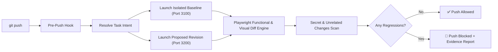

<div align="center">

# 🛡️ ProofPush

### Never push broken website code again.

**A local-first pre-push gatekeeper that spins up your site before and after changes, tests real user behavior with Playwright, and blocks regressions before they hit remote.**

[](https://www.python.org/downloads/)
[](https://playwright.dev/)
[](https://opensource.org/licenses/MIT)
[](#privacy--local-first)

</div>

---

## ⚡ Why ProofPush?

AI coding agents (Claude Code, Cursor, Codex, Gemini CLI) write code fast—**and break websites silently**. 

Conventional linters and code-review bots only read text diffs. They don't know that:
- Your checkout button became unclickable.
- A CSS tweak pushed the navigation bar offscreen on mobile.
- A missing import in client-side code triggers a silent `TypeError` in DevTools.
- An accidental edit introduced an unrelated breaking change or leaked an API key.

**ProofPush tests what your website actually does, not just how its source code looks.**

```
$ git push origin main

============================================================
                         PROOFPUSH
              Local Website Regression Auditor
============================================================
Repository:   ~/projects/acme-store
Task:         Add coupon support to checkout
Baseline:     7ac19f2 → Proposed: a41c0d8
Mode:         STRICT
------------------------------------------------------------
ROUTES CHECKED:       12
FUNCTIONAL WORKFLOWS: 8
VISUAL COMPARISONS:   12 (Desktop & Mobile)
------------------------------------------------------------
RESULTS:
  Passed:             18
  Expected changes:    1
  Regressions:         1
------------------------------------------------------------
🚨 REGRESSION DETECTED
Target: /checkout.html
Before: All network assets and API requests succeeded.
After:  Uncaught TypeError: Cannot read property 'calculateTotal'
Evidence:
- Step 2 failed in workflow 'Standard Checkout'
- Console error captured in DevTools trace
- HTML Evidence Viewer: .change-auditor/reports/report_latest.html
------------------------------------------------------------
🛑 RECOMMENDATION: PUSH BLOCKED
Fix the checkout error or use git push --no-verify to override.
============================================================
```

---

## 🚀 Quickstart (30 Seconds)

### 1. One-Line Install
```bash
git clone https://github.com/mmhtanvir/ProofPush.git
cd ProofPush
./install.sh
```
> Installs Python dependencies, downloads Playwright Chromium binaries, and links the `proofpush` CLI.

### 2. Enable in Any Repository
```bash
cd ~/your-web-project
proofpush install
```
That's it! Every `git push` (from terminal, VS Code, Cursor, or AI CLI) will now be tested before leaving your machine.

---

## 💡 What It Does Behind the Scenes



1. **Zero Working Tree Pollution**: Runs baseline vs proposed in isolated temporary Git worktrees on dynamic ports. Your active files are never touched.
2. **Context-Aware Comparison**: Distinguishes intentional changes from accidental regressions using your commit messages, task files, or AI agent context.
3. **Visual Diffing**: Normalizes viewport dimensions, freezes animations, and generates visual bounding boxes for shifted elements.
4. **Leak Guard**: Scans diffs for leaked secrets (`sk-...`, AWS keys, tokens) and flags deleted test suites.
5. **Chains Existing Hooks**: Preserves your existing pre-push hooks by automatically backing them up and chaining them.

---

## 🛠️ Configuration (`.proofpush.yml`)

ProofPush works out of the box with zero configuration for static sites, but you can configure full-stack apps easily:

```yaml
# .proofpush.yml

# Mode: 'strict' (blocks push), 'interactive' (prompts you), 'advisory' (logs only)
mode: interactive

# How your application starts locally
application:
  type: custom # nextjs, vite, django, fastapi, node
  start_command: "npm run dev -- --port $PORT"
  port: 3000
  health_check: "/"

# Key routes to audit
routes:
  base_routes:
    - "/"
    - "/pricing"
    - "/checkout"

# Critical workflows to verify
workflows:
  - name: "Checkout Navigation"
    path: "/"
    steps:
      - action: navigate
        value: "/"
      - action: click
        selector: "button[data-testid='checkout']"
      - action: assert_url
        expected: "/checkout"

# Visual viewports to compare
visual:
  enabled: true
  diff_threshold: 0.02
  viewports:
    - width: 1280
      height: 800
      name: desktop
    - width: 375
      height: 667
      name: mobile
```

### Examples for Common Frameworks

<details>
<summary><b>Next.js</b></summary>

```yaml
application:
  start_command: "npx next dev -p $PORT"
  health_check: "/"
```
</details>

<details>
<summary><b>Vite / React / Vue</b></summary>

```yaml
application:
  start_command: "npx vite --port $PORT"
  health_check: "/"
```
</details>

<details>
<summary><b>FastAPI / Flask</b></summary>

```yaml
application:
  start_command: "uvicorn main:app --port $PORT"
  health_check: "/health"
```
</details>

<details>
<summary><b>Django</b></summary>

```yaml
application:
  start_command: "python manage.py runserver $PORT"
  health_check: "/"
```
</details>

---

## ⌨️ CLI Commands

| Command | What it does |
|---|---|
| `proofpush install` | Installs the pre-push hook & verifies browser binaries |
| `proofpush review` | Manually runs an audit on your pending commits |
| `proofpush review --full` | Runs a comprehensive audit (multi-viewport, full crawl) |
| `proofpush review --mode strict` | Forces strict blocking mode |
| `proofpush baseline capture` | Saves a verified baseline snapshot of your current commit |
| `proofpush report --open` | Opens the interactive HTML evidence viewer in your browser |
| `proofpush doctor` | Checks health of Git, Playwright, ports, and configuration |
| `proofpush test` | Runs the built-in 30-scenario test suite |
| `proofpush uninstall` | Safely removes hook and restores legacy hooks |

---

## 🔒 Privacy & Local-First

- **100% Local**: No cloud dashboard, no telemetry, no analytics, no remote databases.
- **Zero Token Cost**: Uses a deterministic local classification engine by default.
- **Secret Redaction**: Any credentials or tokens found in logs or reports are automatically scrubbed.

---

## 🧪 Built-in Test Suite

ProofPush is tested against 30 real-world developer scenarios:

```bash
proofpush test
# Ran 30 tests in 11.5s (OK)
```

Includes verification for force-pushes, multi-commit pushes, unattended AI agent pushes, `--no-verify` bypass, prompt injection defense in commit messages, and destructive action prevention.

---

## 📄 License

MIT © [ProofPush Team](https://github.com/mmhtanvir/ProofPush)
