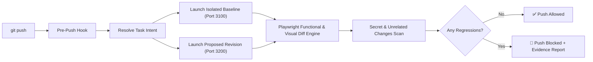

<div align="center">

# 🛡️ ProofPush

### Never push broken website code again.

**A local-first pre-push gatekeeper that spins up your site before and after changes, tests real user behavior with Playwright, and blocks regressions before they hit remote.**

[](https://www.python.org/downloads/)
[](https://playwright.dev/)
[](https://opensource.org/licenses/MIT)
[](#privacy--local-first)

</div>

---

## ⚡ Why ProofPush?

AI coding agents (Claude Code, Cursor, Codex, Gemini CLI) write code fast—**and break websites silently**. 

Conventional linters and code-review bots only read text diffs. They don't know that:
- Your checkout button became unclickable.
- A CSS tweak pushed the navigation bar offscreen on mobile.
- A missing import in client-side code triggers a silent `TypeError` in DevTools.
- An accidental edit introduced an unrelated breaking change or leaked an API key.

**ProofPush tests what your website actually does, not just how its source code looks.**

```
$ git push origin main

============================================================
                         PROOFPUSH
              Local Website Regression Auditor
============================================================
Repository:   ~/projects/acme-store
Task:         Add coupon support to checkout
Baseline:     7ac19f2 → Proposed: a41c0d8
Mode:         STRICT
------------------------------------------------------------
ROUTES CHECKED:       12
FUNCTIONAL WORKFLOWS: 8
VISUAL COMPARISONS:   12 (Desktop & Mobile)
------------------------------------------------------------
RESULTS:
  Passed:             18
  Expected changes:    1
  Regressions:         1
------------------------------------------------------------
🚨 REGRESSION DETECTED
Target: /checkout.html
Before: All network assets and API requests succeeded.
After:  Uncaught TypeError: Cannot read property 'calculateTotal'
Evidence:
- Step 2 failed in workflow 'Standard Checkout'
- Console error captured in DevTools trace
- HTML Evidence Viewer: .proofpush/reports/report_latest.html
------------------------------------------------------------
🛑 RECOMMENDATION: PUSH BLOCKED
Fix the checkout error or use git push --no-verify to override.
============================================================
```

---

## 🚀 Quickstart (30 Seconds)

### 1. One-Line Install
```bash
git clone https://github.com/mmhtanvir/ProofPush.git
cd ProofPush
./install.sh
```
> Installs Python dependencies, downloads Playwright Chromium binaries, and links the `proofpush` CLI.

### 2. Enable in Any Repository
```bash
cd ~/your-web-project
proofpush install
```
That's it! Every `git push` (from terminal, VS Code, Cursor, or AI CLI) will now be tested before leaving your machine.

---

## 💡 What It Does Behind the Scenes



1. **Zero Working Tree Pollution**: Runs baseline vs proposed in isolated temporary Git worktrees on dynamic ports. Your active files are never touched.
2. **Context-Aware Comparison**: Distinguishes intentional changes from accidental regressions using your commit messages, a `.proofpush-task.md` file, or the `PROOFPUSH_TASK` environment variable.
3. **Visual Diffing**: Normalizes viewport dimensions, freezes animations, and generates visual bounding boxes for shifted elements.
4. **Leak Guard**: Scans diffs for leaked secrets (`sk-...`, AWS keys, tokens) and flags deleted test suites.
5. **Chains Existing Hooks**: Preserves your existing pre-push hooks by automatically backing them up and chaining them.
6. **Fixed Bugs Stay Fixed (zero config)**: Reads your Git history for past fix commits (`fix`, `bug`, `hotfix`, ...) touching the files you're pushing, and flags the push if it brings their buggy code back. Works in any language or framework, no setup. Pushes to an existing branch are compared against what is live on it now, so a force-push from a stale checkout can't hide a reverted fix. Add `guard: true` workflows to pin specific bugs in the browser too.

---

## 🔔 Knowing When a Push Was Blocked

- **Terminal:** the report prints right there, followed by git's `failed to push`.
- **Desktop notification:** when nobody is at a terminal (pushes from VS Code, GitHub Desktop, Cursor, an AI agent, or a scheduled `proofpush check`), ProofPush shows an OS notification: macOS Notification Center, `notify-send` on Linux, a tray balloon on Windows. On by default; never in CI.
- **Team channel:** send blocked pushes and failed prod checks to Slack, Discord, or any URL that accepts JSON (Zapier, n8n, your own endpoint):

```yaml
notify:
  desktop: true
  webhook_env: TEAM_WEBHOOK   # put TEAM_WEBHOOK=https://hooks.slack.com/services/... in .proofpush/secrets.env or your environment
```

Slack and Discord get a formatted message; other URLs get `{"text", "event", "repo", "branch"|"environment", "reason", "findings", "report"}`. Secrets are redacted before anything leaves your machine, and a dead webhook never delays a push by more than 5 seconds.

For prod, run `proofpush check --env prod` after each deploy (CI step) or on a schedule (cron); failures reach the same webhook.

---

## 🔐 Test Accounts: Check the Whole Site, Locally and in Prod

Give ProofPush a test account per environment and it logs in, crawls every page reachable by links, and checks each one, including pages behind the login.

```yaml
routes:
  base_routes: ["/dashboard"]   # start here; the first one should need login
  crawl: true                   # follow links to every reachable page
  max_pages: 50
auth:
  login_path: /login
  accounts:                     # names of env vars, never the passwords themselves
    local: {username_env: SHOP_USER,      password_env: SHOP_PASSWORD}
    prod:  {username_env: SHOP_PROD_USER, password_env: SHOP_PROD_PASSWORD, otp_secret_env: SHOP_PROD_OTP}
environments:
  prod: https://shop.example.com
```

Put the values in your shell environment or in `.proofpush/secrets.env` (`SHOP_USER=...`, one per line). ProofPush adds `.proofpush/` to `.git/info/exclude`, so it can't be committed.

- **Local (every push):** both versions are logged in with the `local` account and compared page by page. A push that breaks login is a regression.
- **Prod:** `proofpush check --env prod` logs in with the `prod` account and checks the live site. It is read-only: it follows links with GET, never submits forms, skips logout/delete/cancel links, and runs only workflows marked `prod: true`. Exits 1 on any broken page, so you can run it after a deploy or on a schedule.
- **Login form:** by default the first email/username and password fields are filled and submitted. For anything else, list `auth.steps` (same actions as workflows) using `{username}`, `{password}` and `{otp}`.

**One-time codes (2FA).** ProofPush never bypasses them:
- **Authenticator app (TOTP):** when enabling 2FA for the test account, save its setup secret (the text behind the QR code) as `otp_secret_env`. ProofPush generates the current code itself, fully automatic.
- **SMS / email codes, SSO, captchas:** run `proofpush login --env prod` once. A browser opens, you log in and type the code, and the session is saved to `.proofpush/session-prod.json` (kept out of git). Checks reuse it until it expires, then tell you to log in again.
  For local, point it at your dev server (`proofpush login --env local --url http://localhost:3000`); the session follows the audit to whatever port it runs each version on.

**CAPTCHAs (Cloudflare Turnstile, reCAPTCHA, hCaptcha).** ProofPush never solves them. When one blocks the login it says so, and how to get through:
- **Local:** run the app with the provider's official always-pass test keys through `application.env` (e.g. Turnstile site key `1x00000000000000000000AA`, secret `1x0000000000000000000000000000000AA`). The backend that verifies the token must use the test secret too.
- **Prod:** `proofpush login --env prod` once, solving the CAPTCHA yourself.

Use a dedicated low-privilege test account in prod, never an admin.

---

## 🚨 Suspicious Push Rules

Every push is also checked against **103 rules** for supply-chain and tampering patterns, ported from [Pushguard](https://github.com/saadiqayyum/pushguard)'s catalog (MIT, see `proofpush/PUSHGUARD_LICENSE`). They run locally from git alone, so they work in any repo, including unconfigured ones under `install --global`.

| Pack | Examples |
|---|---|
| Core | force push, trojan-source bidi/invisible characters, code hidden by padding, git hooks, `.gitattributes` filters, submodules |
| CI | `pull_request_target`, secret exfiltration, script injection, unpinned actions, widened permissions |
| AI agents | edits to `CLAUDE.md`/`AGENTS.md`/`.cursor/rules`, hidden text in agent instructions, auto-approve / permission-skip settings |
| JavaScript, Python, Go, Rust, C/C++, JVM, .NET, Ruby, PHP | install hooks, build scripts that run commands, dependencies from URLs, obfuscated payloads |
| Secrets, shell, containers, binaries | committed keys and `.env` files, `curl \| sh`, reverse shells, cron/launchd jobs, privileged containers, committed executables |

- **critical**: blocks in `strict` mode; needs approval in `interactive` (AI agents are blocked)
- **high**: needs approval in `interactive`
- **medium / low**: shown as notices

Six rules need facts only the Git host has (PR review state, the pushing account) and are skipped locally. Tune per repo:

```yaml
push_rules:
  disable: [py-obfuscated-payload]      # rule ids from the finding title
  enable: [rust-unsafe-block-added]     # rules that are off by default
  # enabled: false                      # turn the whole catalog off
```

---

## 🤖 AI Coding Agents

ProofPush runs inside `git push`, so it works with any AI CLI that pushes: Claude Code, Codex CLI, Gemini CLI, Cursor, Aider, Copilot CLI and others. No plugin needed.

- **Never hangs an agent.** In `interactive` mode a person at a terminal is asked `Approve push anyway?` (via `/dev/tty`, since git uses the hook's stdin). Agents are never prompted: anything without a terminal is treated as unattended, and these are detected even when they run commands in a real PTY:

  | Env var | Tool |
  |---|---|
  | `CLAUDECODE` | Claude Code |
  | `GEMINI_CLI` | Gemini CLI |
  | `CODEX_SANDBOX`, `CODEX_SANDBOX_NETWORK_DISABLED` | Codex CLI |
  | `CURSOR_AGENT` | Cursor |
  | `CI` | CI runners |
  | `PROOFPUSH_NONINTERACTIVE=1` | Anything else: set it in your agent's environment |

- **Blocks with instructions the agent can act on.** Unattended pushes with findings are blocked (`policies.interactive_fallback: block`, the default). The output names the agent, points to the Markdown report, and tells it to fix the findings or ask you, and not to bypass with `--no-verify`.
- **You approve one push** with `PROOFPUSH_MODE=advisory git push` (hooks can't take flags, so `PROOFPUSH_MODE` overrides the mode for that push).
- **Tell ProofPush what the agent was doing**: `PROOFPUSH_TASK="Add coupon support" git push`, or write `.proofpush-task.md`.
- **Survives agent timeouts.** If the agent kills the push, ProofPush still removes its temporary worktrees and stops the app servers.
- **Works from GUI-launched tools** whose PATH lacks `proofpush`: the hook remembers the install path.

---

## 🛠️ Configuration (`.proofpush.yml`)

ProofPush works out of the box with zero configuration for static sites, but you can configure full-stack apps easily:

```yaml
# .proofpush.yml

# Mode: 'strict' (blocks push), 'interactive' (prompts you), 'advisory' (logs only)
mode: interactive

# How your application starts locally
application:
  type: custom # nextjs, vite, django, fastapi, node
  start_command: "npm run dev -- --port $PORT"
  port: 3000
  health_check: "/"

# Key routes to audit
routes:
  base_routes:
    - "/"
    - "/pricing"
    - "/checkout"

# Critical workflows to verify
workflows:
  - name: "Checkout Navigation"
    path: "/"
    steps:
      - action: navigate
        value: "/"
      - action: click
        selector: "button[data-testid='checkout']"
      - action: assert_url
        expected: "/checkout"

  # guard: true pins a previously fixed bug. If it fails, the push is flagged as a
  # regression even when the baseline fails too (e.g. a stale checkout undoing a fix).
  - name: "Coupon updates order total (bug fixed in #42)"
    path: "/checkout"
    guard: true
    steps:
      - action: fill
        selector: "#coupon"
        value: "SAVE10"
      - action: click
        selector: "#apply-btn"
      - action: assert_text
        selector: "#total"
        expected: "$90.00"

# Visual viewports to compare
visual:
  enabled: true
  diff_threshold: 0.02
  viewports:
    - width: 1280
      height: 800
      name: desktop
    - width: 375
      height: 667
      name: mobile
```

### Examples for Common Frameworks

<details>
<summary><b>Next.js</b></summary>

```yaml
application:
  start_command: "npx next dev -p $PORT"
  health_check: "/"
```
</details>

<details>
<summary><b>Vite / React / Vue</b></summary>

```yaml
application:
  start_command: "npx vite --port $PORT"
  health_check: "/"
```
</details>

<details>
<summary><b>FastAPI / Flask</b></summary>

```yaml
application:
  start_command: "uvicorn main:app --port $PORT"
  health_check: "/health"
```
</details>

<details>
<summary><b>Django</b></summary>

```yaml
application:
  start_command: "python manage.py runserver $PORT"
  health_check: "/"
```
</details>

---

## ⌨️ CLI Commands

| Command | What it does |
|---|---|
| `proofpush install` | Installs the pre-push hook & verifies browser binaries |
| `proofpush review` | Manually runs an audit on your pending commits |
| `proofpush review --full` | Runs a comprehensive audit (multi-viewport, full crawl) |
| `proofpush review --mode strict` | Forces strict blocking mode |
| `proofpush check --env prod` | Logs in with the prod test account and checks every reachable page of the live site (read-only) |
| `proofpush login --env prod` | Log in by hand once (SMS/email codes, SSO) and save the session for checks |
| `proofpush review --history-only` | Git-only checks (reverted past fixes, secrets), no app or browser |
| `proofpush baseline capture` | Saves a verified baseline snapshot of your current commit |
| `proofpush report --open` | Opens the interactive HTML evidence viewer in your browser |
| `proofpush doctor` | Checks health of Git, Playwright, ports, and configuration |
| `proofpush test` | Runs the built-in 49-scenario test suite |
| `proofpush install --global` | Enables ProofPush in every repo on this machine. Repos without `.proofpush.yml` get git-only checks; each repo's own `.git/hooks` keep running |
| `proofpush uninstall` | Safely removes hook and restores legacy hooks |

---

## 🔒 Privacy & Local-First

- **100% Local**: No cloud dashboard, no telemetry, no analytics, no remote databases.
- **Zero Token Cost**: Uses a deterministic local classification engine by default.
- **Secret Redaction**: Any credentials or tokens found in logs or reports are automatically scrubbed.

---

## 🧪 Built-in Test Suite

ProofPush is tested against 49 real-world developer scenarios:

```bash
proofpush test
# Ran 49 tests in 12s (OK)
```

Includes verification for force-pushes, multi-commit pushes, unattended AI agent pushes, `--no-verify` bypass, prompt injection defense in commit messages, destructive action prevention, and reverted past fixes.

---

## 📄 License

MIT © [ProofPush Team](https://github.com/mmhtanvir/ProofPush)
